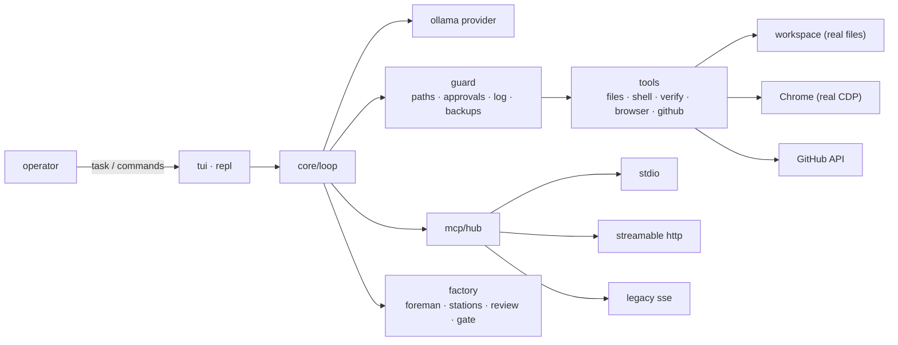

<div align="center">


# OGI

**An agent that actually works on your machine.**

It reads the repository, edits real files, runs the real tests, drives a real
Chrome, and pushes to GitHub — through tools, not through promises. It stops
when its budget or its permissions run out.

[](https://bun.sh)
[](https://www.typescriptlang.org/)
[](#development)
[](https://modelcontextprotocol.io)
[](#tools)
[](#requirements)

</div>

---

## Contents

- [Why OGI](#why-ogi)
- [Quick start](#quick-start)
- [Two ways to work](#two-ways-to-work)
- [The workspace](#the-workspace)
- [The full screen](#the-full-screen)
- [Commands](#commands)
- [MCP servers](#mcp-servers)
- [Plugins](#plugins)
- [Approval tiers](#approval-tiers)
- [Safety](#safety)
- [The factory line](#the-factory-line)
- [Tools](#tools)
- [Configuration](#configuration)
- [Architecture](#architecture)
- [Development](#development)
- [Troubleshooting](#troubleshooting)
- [Roadmap](#roadmap)
- [Credits](#credits)

## Why OGI

Most "terminal agents" are a chat loop with a shell taped to it. OGI is built
around the part that actually decides whether you can leave it alone: **what a
tool is allowed to do, and what happens when it tries something else.**

| | |
| --- | --- |
| **Runs** | on your machine, against real files and a real Chrome |
| **Model** | any tag `ollama serve` answers, local or `:cloud` |
| **Network** | the sites you point it at, `api.github.com`, and the MCP servers you attach |
| **Effects** | every tool is graded `read`, `compute`, `write` or `outward` before it runs |
| **Floor** | the system, irreplaceable files, writes outside the project and outward actions stop at every tier |
| **Record** | one JSONL line per call in `.agent/log`, backups before every write, `undo` to put one back |
| **Not** | a chatbot wrapper, a cloud sandbox, a framework you must learn, a telemetry pipeline |

Concretely, that means:

- **A write is reviewed as a diff before it happens** — the real patch, sized to
  the patch, with the cursor on **No** by default.
- **The model cannot talk its way past the guard.** Paths resolve inside the
  workspace or are refused; secret files are refused; destructive commands are
  refused unless a person approves that exact call.
- **A project's MCP server is not trusted because it is text in a repository.**
  It runs only after its exact fingerprint is approved, and editing it reopens
  the question.
- **The factory line splits context, not just work.** A scout carries its
  reading; the builder gets the artefact, not a 40k-character file dump.

## Quick start

Requirements:

- **Bun 1.2+** — it runs the TypeScript directly; there is no build step.
- **Ollama 0.40+** with at least one model pulled, or an Ollama cloud key.
- **Git for Windows' `bash.exe`** for `run_command` (found on its own, or set
  `AGENT_BASH`).
- **Chrome or Edge** for the browser tools. Everything else works without them.

Verified on Windows 10 22H2 with Bun 1.4. The line UI and every tool are plain
TypeScript; the bundled full-screen renderer is the win32-x64 build of OpenTUI.

```bash
git clone https://github.com/nixos69963-png/ogi.git
cd ogi
bun install
bun setup.ts        # puts `ogi` and `agent` on PATH; no files are copied
ogi doctor          # what this machine can and cannot do
ogi                 # the full screen, in this directory
```

`setup.ts` writes two small shims into `~/bin` — a `.cmd` for cmd/PowerShell and
a bash script for Git Bash/WSL. Each one starts this checkout by absolute path
and passes the directory you launched from as the workspace, so there is nothing
to rebuild and an edit here is live in the next run.

Run it without installing anything:

```bash
bun bin/agent.ts doctor
bun bin/agent.ts do "add a --json flag" -y
```

The command answers to both `ogi` and `agent`; they are the same program.

## Two ways to work

```bash
ogi                                      # the full screen: talk, watch, approve writes as they come
ogi do "add a --json flag"               # one unattended run, then exit
ogi do "fix the failing test" -y --json  # scriptable; machine-readable result
ogi factory "migrate config to toml"     # the line: foreman, stations, review, gate
```

`do` and `factory` are the strict modes. Nobody is watching, so an outward
action — a comment, a pull request, a click on someone else's page — is
**refused**, not queued for an answer that will never arrive. The same is true
for anything the tier does not wave through by policy: a step that reaches the
machine, a file that cannot be re-created, a call a tool flagged as worth a
second look.

Writes need a tier to run unattended:

```bash
ogi do "format the tree" -y                 # routine writes and plain commands
ogi do "refactor the parser" --approve full # every write inside the project
```

Inside the session, a bare `/` lists every command and `↑↓` picks one. `/help`
prints the same list as text. `/line` shows the factory plan on disk and
`/line resume` continues it. `/undo <path>` puts a file back. `/stop` or Ctrl+C
ends the run in flight.

Two commands teach it your project: `/init` writes a starter `AGENT.md` from the
manifest, and `/memory` shows exactly what was loaded, with cut sizes.
`AGENTS.md` and `AGENT.md` are both read, and a copy under `~/.agent/AGENT.md`
applies to every project. Any `*.md` file dropped in `.agent/commands/` — or in
`~/.agent/commands/` — becomes a slash command: the body is the prompt, `$1`…`$9`
take words, `$ARGUMENTS` takes the rest, and a project command wins over a user
command with the same name.

## The workspace

**The workspace is the directory you launch from.** There is no hidden default,
no "last project" and no config file that quietly points somewhere else:

```bash
cd ~/code/my-app
ogi                 # workspace is ~/code/my-app
ogi -w ~/code/lib    # or say it explicitly
```

`setup.ts` makes this explicit in the shim as well: it passes `%CD%` (cmd) or
`$PWD` (bash) as `-w`, so a shortcut, a terminal profile or a parent process
cannot silently change the answer. A `-w` you type after it still wins.

If the workspace resolves to **the agent's own checkout**, OGI says so once at
startup:

```
note: this is the agent's own folder — run from your project, or pass -w <dir>
```

That is the one place where starting in the wrong directory is easy to miss and
expensive to discover later: the next run would edit the agent instead of your
project.

`.env` is read from the workspace, then from its parent, and stops at the first
file it finds. Real environment variables win over both. Inside another project
that parent file is that project's `.env`, so `ogi config` is worth running once
after any move.

## The full screen

`ogi` on a real terminal is one screen with fixed parts, not a scroll of text:

```
agent  myproj  ·  gemma4:31b-cloud  ·  D:\workstation                   running
❯ make notes/b.md say what it should say
● Write(file_path: "notes/b.md") +1
  ⎿  ✓ 0.1s · +3 −0 · 39 chars
    1 + written on the real console
    2 + line two
notes/b.md written
              20 min · 11 messages · ~1341 tokens · last run 2 turns 320 tokens
────────────────────────────────────────────────────────────────────────────────
❯ a task, or / for commands, or @ to hand over a file
────────────────────────────────────────────────────────────────────────────────
▸▸ writes ask (/approve ask|auto|full · outward and the system always ask)
```

A call is a green bullet with a bold name, and whatever it produced hangs under
it on a `⎿`. What you typed keeps its own grey band, so your words are never
mistaken for the agent's. Typing happens between two hairlines — the only frame
on the screen — with the list you are choosing from above them and the mode you
are in below them. Nothing else is boxed, and nothing is picked out with a
filled block: the pointer is a `❯` and the chosen word takes its colour.

The transcript holds finished rows; the live line holds the ticking one; the
prompt stays where you can see it, so the screen never scrolls away from where
you type. `--classic` forces the scrolling line UI, `--tui` forces the screen,
and `AGENT_CLASSIC=1` does the first for every run. Piped output (a file, a test)
falls back to the line UI by itself.

A bare `/` or an `@` opens its list above the box, in two columns:

```
❯ /model <name>   switch model for this session
  /models         what this ollama daemon can run
  ↑↓ choose · Tab insert · Enter run · Esc hide · 2 shown
────────────────────────────────────────────────────────────────────────────────
❯ /mo
────────────────────────────────────────────────────────────────────────────────
```

**`@` hands a file over.** Type `@notes/` and the files under that prefix appear;
Tab or Enter puts the path into your sentence, and the task starts with its
contents already in the model's context. The row says so — `injected notes/a.md
(2 lines)` — so you know what the model was given without asking it.

**A write is reviewed as a diff, before it happens.** `edit_file` and `write_file`
open a pane with the real patch in it, sized to the patch. It takes the box's
place at the bottom of the screen, so there is never a second set of rules:

```
────────────────────────────────────────────────────────────────────────────────
● Write [notes/b.md]  write_file · write  unified
 │
 └── will change notes/b.md with 2 additions and 0 removals

  1 + created by the probe
  2 + line two

Do you want to proceed?
  1. Yes — do it
  2. Yes, and do not ask again for this tool this run
❯ 3. No — leave it undone

esc says no · enter runs the choice · y / a / n · v unified|split · PgUp PgDn scroll
```

Added rows are green on a dark green ground, removed rows red on dark red — the
only fills besides the pointer's colour. The `└──` line counts from the patch,
not from the result: it says what *will* change, while the write is still undone.
`v` turns the same patch sideways (split), PgUp/PgDn scroll a long one, and the
default cursor sits on **No** — silence is not permission. Esc is a refusal, and
so is Ctrl+C, which stops the run and puts the pane down.

The agent's own question (`request_input`) takes the same shape under a
`? question` chip, with a row to type an answer the list did not offer. Esc there
ends the run rather than guessing.

Every one of these screens is proven frame by frame in `test/tui.test.ts` against
a scripted provider — no model, no token — including that a `no` leaves the file
unwritten on disk, and that no span of the review pane carries a blue background.

## Commands

### Entry points

| Command | What it does |
| --- | --- |
| `ogi` | the full screen in the current directory |
| `ogi do "<task>"` | one unattended run, then exit |
| `ogi factory "<task>"` | run the task through the factory line |
| `ogi models` | what this Ollama daemon can run |
| `ogi config` | the settings that were actually resolved |
| `ogi doctor` | check the machine before the first run |
| `ogi log [n]` | recent actions it took, from `.agent/log` |
| `ogi backups` | files it can put back |
| `ogi undo <path\|id>` | restore one of them |
| `ogi mcp …` | list, add, get, test, approve or remove MCP servers |
| `ogi plugin …` | list plugins, or install one with `plugin add <path>` |

### Options

```
-w, --workspace <dir>   project to work in          (default: cwd)
-m, --model <name>      ollama model                (default: $AGENT_MODEL)
-b, --budget <min|until> working time for the run
-y, --yes               run the routine work unasked (outward still asks)
    --approve <tier>    ask · auto · full
    --full-access       the same as --approve full
    --classic           the scrolling line UI instead of the full screen
    --tui               insist on the full screen here
    --json              machine-readable result for `do` and `factory`
    --file <path>       read the task from a file
    --resume            factory: continue .factory/plan.json
```

### In-session

`/help` `/stop` `/factory` `/line` `/line resume` `/model` `/budget` `/tools`
`/mcp` `/mcp add` `/mcp remove` `/mcp approve` `/mcp restart` `/memory` `/init`
`/log` `/backups` `/undo` `/approve` `/resume` `/clear` `/compact` `/models`
`/config` `/exit`

## MCP servers

Any server that speaks the **Model Context Protocol** can be attached. Its tools
join the run as `mcp__<server>__<tool>`, over stdio, streamable HTTP, or the older
SSE transport. The client speaks protocol `2025-06-18`.

```bash
# a local stdio server
ogi mcp add fs -- npx -y @modelcontextprotocol/server-filesystem .

# a remote server with a header and an env var
ogi mcp add api --transport http --url https://example.com/mcp \
  -H "Authorization: Bearer ${TOKEN}"

# the same entry as JSON, or added to this repository's .mcp.json
ogi mcp add-json fs '{"command":"npx","args":["-y","@modelcontextprotocol/server-filesystem","."]}'
ogi mcp add fs --project -- npx -y @modelcontextprotocol/server-filesystem .

ogi mcp list | get <name> | test <name> | remove <name>
```

Inside a session the same thing is one line:

```
/mcp add echo2 -- bun ./scripts/echo-server.ts
/mcp add remote --url https://example.com/mcp
/mcp approve <name> | /mcp restart <name> | /mcp remove <name>
```

`--project` writes to the repository's `.mcp.json` instead of
`~/.agent/mcp.json`. A project server is text in someone else's repository, so
it does not run until that exact definition is approved (`ogi mcp approve <name>`,
or `/mcp approve <name>` in a session). Editing its command, args, env, URL or
headers reopens the question; removing the server revokes the approval.
`AGENT_MCP=0` turns the client off entirely.

Every MCP tool is a `write` and is gated like one: `readOnlyHint` never loosens
the gate, `destructiveHint` raises it. The only unasked path is the operator's
`allow` list, written before the run (`--allow tool`, or `*` for every tool on
that server). What a server returns is data, never an instruction, and the
approval line redacts the arguments.

## Plugins

Plugins use Claude Code's folder shape: `~/.agent/plugins/<name>` (trusted) or
`.agent/plugins/<name>` (project; its servers wait for approval).
`plugin.json` / `.claude-plugin/plugin.json` can declare `mcpServers`, and every
`commands/**/*.md` becomes `/<plugin>:<name>`.

```bash
ogi plugin list
ogi plugin add ~/code/my-plugin
ogi plugin add ./.agent/plugins/my-plugin --project
```

Servers from a plugin are namespaced `plugin:<plugin>:<server>`, so two plugins
can ship a server with the same name. Agents, skills, hooks and output styles are
reported as unsupported instead of half-run. `/mcp` shows the live state of every
server inside a session.

## Approval tiers

Three tiers, one switch: `/approve ask|auto|full` inside a session,
`--approve <tier>` or `-y` on the command line, `AGENT_APPROVAL_LEVEL` in `.env`.
The foot of the full screen always says which one you are in, so the answer to
"do I have to click through this?" is visible before you commit to it.

| Tier | Runs on its own | Still asks |
| --- | --- | --- |
| `ask` (default) | reads, computes | every write, every outward step |
| `auto` (`-y`) | reads, computes, plain writes, ordinary commands | risky writes and commands, outward steps, anything below |
| `full` (`--full-access`) | every write inside the project, risky ones included | the four things below |

The tier is a floor, not a dial: the same four things ask at `full` exactly as
loudly as at `ask`, and the switch can only ever widen what runs inside the
project.

- **It reaches the machine.** The registry, scheduled tasks, the network stack, a
  service, `taskkill /f`, a shutdown, another user's rights, `setx`, git config
  `--global`, a `-g` package install, permissions, a disk, a pipe from the
  internet into a shell, `~/.ssh`, `C:\Windows`.
- **It cannot be re-created.** A manifest or lockfile, a tsconfig, a Dockerfile,
  `README`, `AGENTS.md`, `.gitignore`, an `.env`, or anything under `.git`,
  `.agent`, `.factory`, `.ssh`. Deleting one is a question even at `full` — and a
  delete that arrives as `rm package.json` in a command is graded exactly like
  the `remove_path` tool, because a command leaves no backup of its own.
- **It leaves the project.** A write outside the workspace folder.
- **It acts outward.** A comment, a pull request, a push, a click on someone
  else's page. `outward` never auto-approves, and with nobody watching it is
  refused rather than queued for an answer that will never arrive.

A hard gate answers the same way a risky call does — yes, no — but choosing "yes,
and do not ask again for this tool" does not lift it: that grant is for the
routine calls, and the reason this one was asked stands for the whole run.

## Safety

Every rule below is enforced in code as well as in the brief, because a prompt
is a request and the guard is a guarantee.

- **Workspace guard.** Paths resolve inside the workspace or are refused.
  `AGENT_ALLOW_OUTSIDE=true` is the only way past, and it is a decision, not a default.
- **Secret deny list.** `.env`, private keys and credential stores are refused —
  reading one sends its contents to the model, writing one overwrites a credential.
  `.env.example` is deliberately readable.
- **No secrets in command lines.** `run_command` refuses a URL with embedded
  credentials or a literal GitHub token. `github_push` hands the token to git
  through a credential helper that reads it from the environment, so it stays out
  of argv, the process list, the log and `.git/config`.
- **Destructive commands refused** — recursive delete, hard reset, formatting —
  unless the operator approves them by name.
- **Captcha and bot-detection refusal.** The agent says so and stops; a person
  does that step. There is no evasion mode.
- **Log.** `.agent/log/<date>.jsonl`, one line per call with its arguments
  redacted. `ogi log [n]` reads it back. There is no off the record.
- **Backups.** A write copies the previous contents to `.agent/backups` first.
  `ogi undo <path|id>` puts it back.
- **Stop.** Ctrl+C or `/stop` ends a run mid-flight; budget expiry does the same.
  A spawned Chrome and the persistent bash session are the agent's own to close,
  and both are closed on exit.
- **Context.** Tool output is clipped, the transcript is compacted before it is
  full, and every token that stays in it was earned.

## The factory line

The single-transcript loop is fine for a task you can hold in your head. Most
real tasks are not that. The factory splits the work and, more importantly,
splits the context: each station gets its own transcript, its own tool list, and
its own slice of the budget, so a scout never carries 40k characters of file
dump into the station that has to write code.

1. **Foreman** plans 1–6 stations. Each one has a kind, a goal, and what it
   accepts against. A plan with no verifier gets one appended before the line
   starts: a line that ends with a writer has no one who checked.
2. **Stations** run in order — `scout` (read-only), `builder` (writes),
   `verifier` (runs the checks). Each hands off by writing
   `.factory/artifacts/<id>.json`, validated against its contract before it
   touches disk. A rejected call returns the shape it wanted, not a wall of text.
3. **Review** — a read-only gauge reads the artefact and the diff, and can only
   ask for changes. It cannot write, so it cannot "fix" its way past a problem.
   Two rounds, then the station is marked failed and the line moves on.
4. **Ship gate** — nothing passes on assertion. The gate re-reads the plan, the
   artefacts and `.agent/log`, and refuses a station whose artefact is missing,
   breaks its contract, was never reviewed clean, or claims a file the log says
   was never touched.

`--resume` picks up the first unfinished station. The whole state is on disk, so
a crashed run loses the current step, not the work.

## Tools

Thirty-seven tools in a normal run, plus `write_artifact` that only a station on
the line gets. The effect on each one is what the approval layer reads.

| Effect | Tools | What happens |
| --- | --- | --- |
| `read` | `read_file` `list_dir` `glob` `grep` `proc_output` `proc_list` `web_fetch` `browser_open` `browser_state` `browser_extract` `browser_scroll` `browser_tab` `browser_history` `github_issue` `github_issues` `github_ci` | runs freely, inside the guard |
| `compute` | `plan_update` `finish` `request_input` `delegate` `write_artifact` `browser_screenshot` `browser_close` | in-process, asks nothing |
| `write` | `verify` `write_file` `edit_file` `move_path` `remove_path` `run_command` `run_background` `stop_process` | asks first; the tier decides how much runs unasked |
| `outward` | `browser_click` `browser_type` `browser_press` `browser_select` `github_comment` `github_pr` `github_push` | **needs a person.** Unattended means refused, not auto-approved |

Loading a page is a read — a GET that changes nothing on the site, in a Chrome
profile that holds no log-ins. Clicking and typing are not reads, and they ask.
MCP tools are not in this table because they are not ours: they arrive as `write`
tools with the server's own schemas and hints.

Two of those tools exist to keep the model from improvising the boring parts:

- **`verify`** runs the project's own proof and nothing else: the `check` script
  when `package.json` has one, otherwise typecheck/lint/test, otherwise tsc,
  pytest, cargo or go. It returns `✓/✗ label — command · exit · time` plus only
  the first errors of the first failing step. The model does not choose the
  command; that is what makes it a shortcut rather than a quieter shell. A check
  that would delete work still hits the gate.
- **`delegate`** hands one focused research question to a subagent with its own
  transcript. Its tool list is read-only — files, search, fetch, and the parts of
  the browser that only look — so it cannot write, run a command or click. The
  parent gets the report, not the reading it took to write it.

## Configuration

Copy `.env.example` to `.env` in the workspace, or set real environment
variables — those win. `ogi config` prints what was actually resolved.

| Setting | Default | What it does |
| --- | --- | --- |
| `AGENT_MODEL` | `gemma4:31b-cloud` | any tag the daemon can serve; `:cloud` is billed by the provider |
| `OLLAMA_BASE_URL` | `http://127.0.0.1:11434` | the Ollama daemon |
| `AGENT_WORKSPACE` | — | pin a workspace; the installed shims pass the launch directory first |
| `AGENT_ALLOW_OUTSIDE` | `false` | allow writes outside the workspace |
| `AGENT_ALLOW_SECRETS` | `false` | allow reading `.env`, keys and credential stores |
| `AGENT_BUDGET_MINUTES` | — | working time; empty means turns alone |
| `AGENT_MAX_OBSERVE_CHARS` | `12000` | cap on one tool result in the transcript |
| `AGENT_CONTEXT_TOKENS` | `60000` | transcript budget |
| `AGENT_COMPACT_AT_PERCENT` | `0.75` | when to compact |
| `AGENT_APPROVAL_LEVEL` | `ask` | `ask`, `auto` or `full` |
| `AGENT_BROWSER_EXECUTABLE` | auto | Edge, Brave or a headless shell |
| `AGENT_BROWSER_PORT` | `9333` | DevTools port; privileged ports are ignored |
| `AGENT_BROWSER_PROFILE` | own profile | no sign-ins, no cookies from your daily browser |
| `AGENT_BROWSER_HEADLESS` | `false` | run Chrome without a window |
| `GITHUB_TOKEN` | — | fine-grained PAT; without it GitHub is read-only |
| `GITHUB_REPO` | — | default `owner/name` for the GitHub tools |
| `AGENT_MCP` | on | `0` disables every MCP server |
| `AGENT_MCP_TRUST_PROJECT` | off | `1` trusts project servers without approval — never leave it on |
| `AGENT_BASH` | auto | path to `bash.exe` |
| `AGENT_SHOW_THINKING` | `0` | stream the model's reasoning |
| `AGENT_FORCE_COLOR` | `0` | colour in a pipe |
| `AGENT_TEST_TMP` | system temp | scratch root for the suite |

The one that matters most: `GITHUB_TOKEN`. Use a fine-grained personal access
token, scoped to the repositories you name, expiring monthly. Without it GitHub
is read-only, which is a perfectly good default.

`AGENT_MCP` and `AGENT_MCP_TRUST_PROJECT` are read from the real environment,
not from `.env`.

## Architecture



One call, end to end:

1. The model proposes a tool call.
2. The tool's **effect** is read from its spec — not from the model's description.
3. The guard resolves every path against the workspace and refuses secrets.
4. The approval layer applies the tier, the risky-call floor and any session grant.
5. A write backs up the previous contents first.
6. The tool runs for real; the result is clipped and logged.
7. Only the clipped observation enters the transcript.

A refusal is returned to the model as text, so it can try a legal route. It
cannot retry its way through a gate.

### Layout

```
setup.ts            one-time PATH installer for `ogi` / `agent`
bin/agent.ts        the command line: arguments, subcommands, teardown
src/core/           config, ollama provider, the loop, budget, history, the brief
src/guard/          path guard, approvals, redaction, log, backups
src/tools/          the 37 tools, one file per kind of surface
src/factory/        plan, briefs, artefacts, the ship gate, the foreman
src/browser/        CDP over a hand-written WebSocket client — no playwright
src/mcp/            config, trust, the three transports, tool specs, the hub
src/ui/             terminal, renderer, REPL — the line UI, and the fallback
src/tui/            the full screen: rows, session, transcript, OpenTUI app
test/               the suite and its scripted model
assets/             the mark the screen reads
```

## Development

```bash
bun test              # 305 tests, no model, no token
bun run typecheck     # strict, with noUncheckedIndexedAccess
bun run check         # both
```

There is no build step and no linter. `bun run check` running green is the gate.

Nothing in the suite reaches a provider or an API: GitHub calls are stubbed and
recorded, so a test can count exactly how many times a token appeared in a
request. The exceptions are local by nature — one git push into a bare repo on
disk, and one hostname resolved through DNS, because that resolution is part of
the SSRF guard.

The suite tests the harness the way it fails in practice: an approval that would
auto-pass an outward action, a repair round that stores its artefact as a review,
a token that reaches a command line. `test/helpers.ts` plays back scripted turns
by role, which is how "a scout cannot write" is proved rather than claimed.

One runtime dependency: `@opentui/core` for the full screen. Everything else —
the CDP client, the MCP transports, the GitHub client — is written by hand.

## Troubleshooting

**`ogi` is not recognized.** Open a new terminal after `bun setup.ts`. If the
install directory is not on PATH, setup prints the exact line to add; a custom
target is one flag away: `bun setup.ts --dir <path>`.

**It works on the wrong folder.** The workspace is the directory you launch
from. Check `ogi config` for the resolved path, pass `-w <dir>` explicitly, or
look for the startup note that says the workspace is the agent's own checkout.
If an old copy exists, `where ogi` (cmd/PowerShell) or `which -a ogi` (bash)
shows which one wins.

**`run_command` cannot find bash.** Install Git for Windows, or set
`AGENT_BASH=C:\Program Files\Git\bin\bash.exe`.

**The browser tools are off.** `ogi doctor` says whether Chrome was found. Point
`AGENT_BROWSER_EXECUTABLE` at Edge, Brave or a headless shell. OGI uses its own
profile, so it does not touch your daily log-ins — and it will not solve a
captcha for you.

**A `:cloud` model is missing from `ogi models`.** Cloud tags are not listed by
`/api/tags`; they are billed by the provider. Set `AGENT_MODEL` directly.

**A project MCP server says "pending".** That is the trust gate. Read the entry
with `ogi mcp get <name>`, then approve that exact definition with
`ogi mcp approve <name>`. Editing it asks again.

## Roadmap

- **Team mode** — several specialised agents sharing one local MCP hub for work
  that genuinely parallelises.
- **Scheduled runs** — cron-like background tasks with the same gate and the same
  log, never a quieter side door.
- **Long-term memory** — local retrieval across sessions and projects, opt-in
  and inspectable, not a hidden embedding upload.
- **Deeper browser workflows** — session management and multi-tab research.
- **Self-healing loops** — after a write, run the project's own proof and iterate
  until it passes, then report what changed.

## Credits

This agent was designed against the reference projects kept locally in
`resources/` — MIX-agentic, OpenManus, browser-use, and the Eve factory
templates. They are read-only evidence for how those systems fail in practice;
nothing in this repository imports or redistributes them.

The full screen is built on [OpenTUI](https://github.com/sst/opentui). The model
transport speaks to [Ollama](https://ollama.com). MCP follows the
[Model Context Protocol](https://modelcontextprotocol.io).
